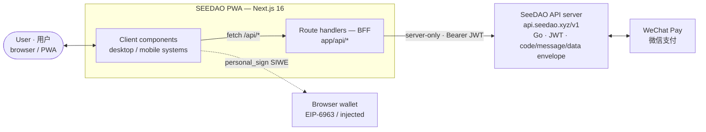
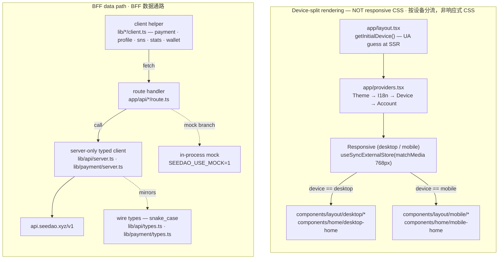
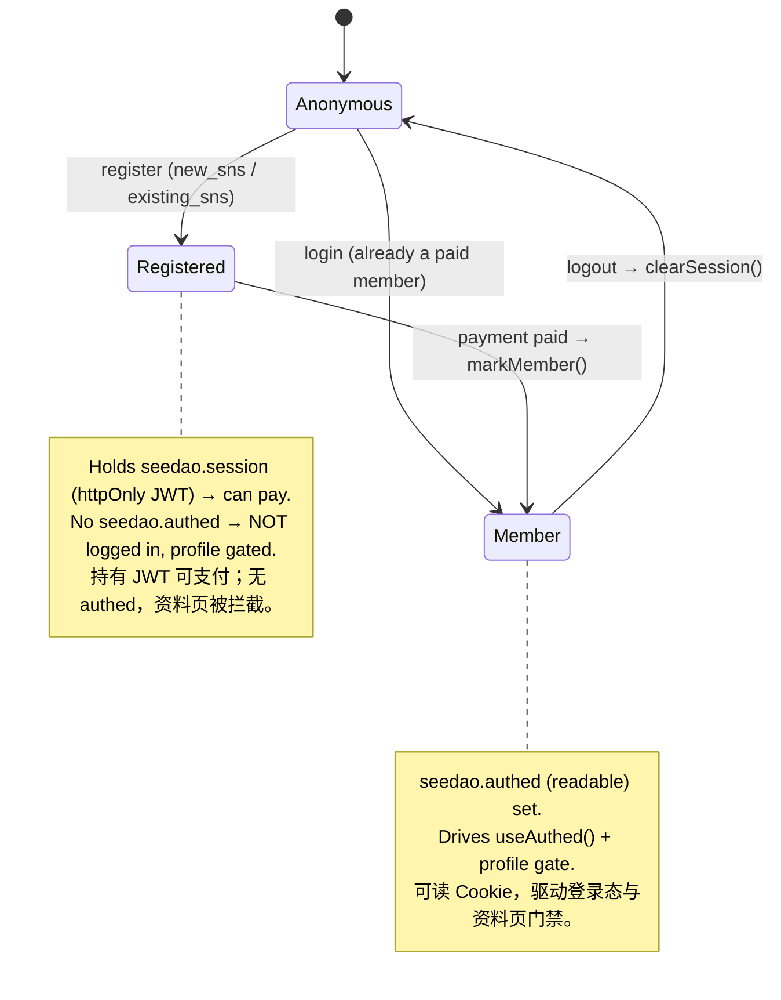
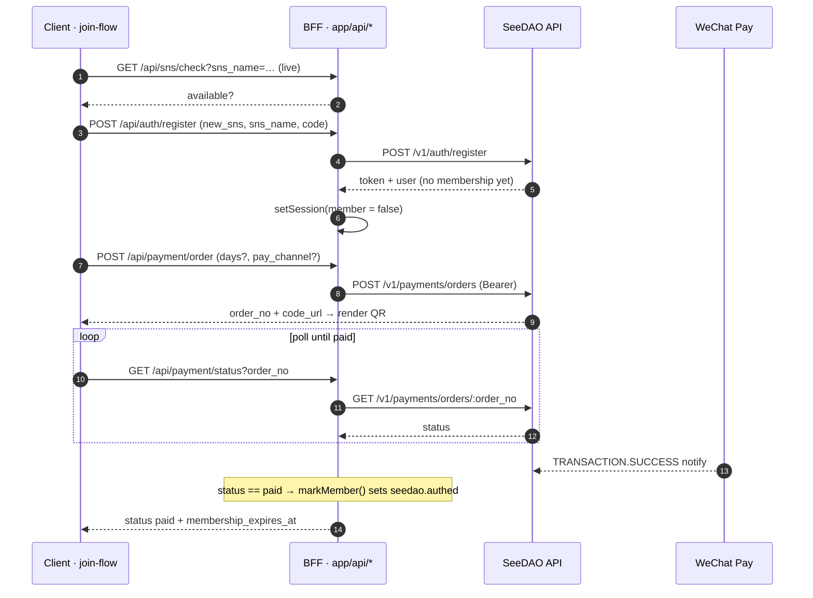
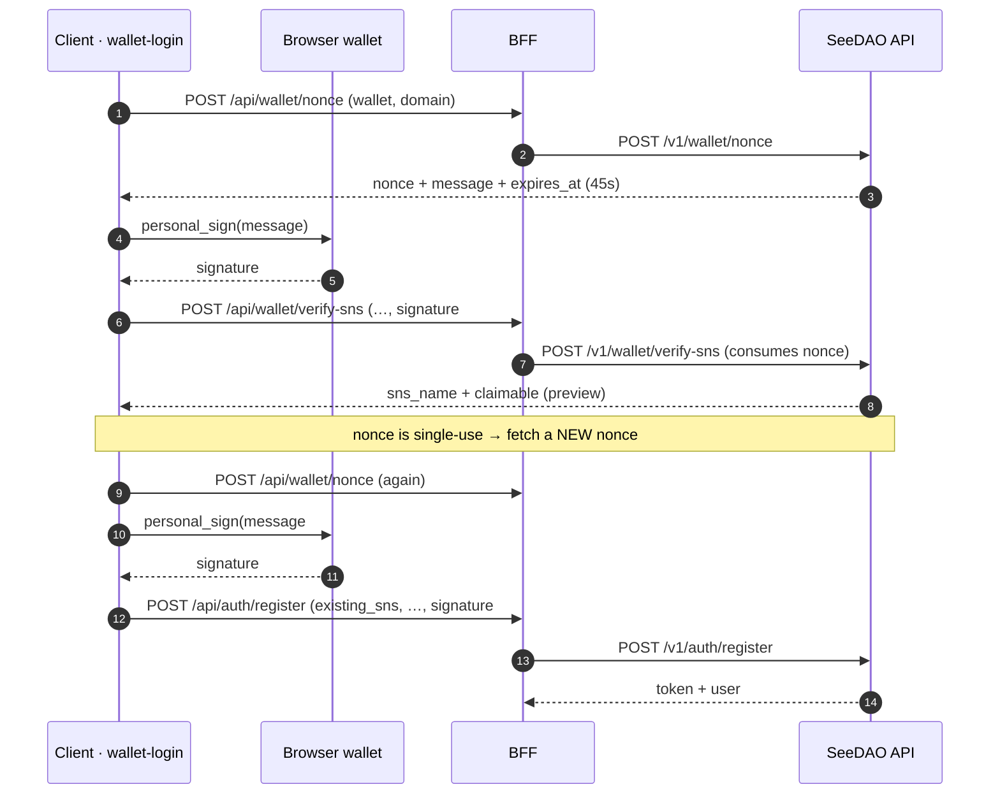

# Architecture · 架构

> A map of the SEEDAO PWA codebase: how the pieces fit, the few conventions that
> are non-obvious, and where to look when you change something.
>
> SEEDAO PWA 代码地图：各部分如何协作、几条不显而易见的约定，以及改动时该去看哪里。

[中文](#中文) · [English](#english)

---

## Diagrams · 架构图

These diagrams are shared by both language sections below. Node labels use the
real file paths and identifiers from the code.
以下架构图为中英文两节共用，节点标签直接采用代码中的真实路径与标识符。

### 1. System context · 系统上下文

How the app sits between the user, the SeeDAO backend, and external services.
应用如何处在「用户 — SeeDAO 后端 — 外部服务」之间。



### 2. Rendering & data path · 渲染与数据通路

The two defining patterns: **device-split rendering** (left) and the **BFF data
path** (right).
两大核心模式：**按设备分流渲染**（左）与 **BFF 数据通路**（右）。



### 3. Session & auth state · 会话与认证状态

"Logged in" means **active paid member**, not merely registered. Two cookies
encode this.
「已登录」指**活跃付费会员**，而非仅完成注册。由两个 Cookie 编码。



### 4. Join + WeChat Pay (new_sns) · 加入 + 微信支付

The home "Join" flow: check name → register (free) → open order → poll → member.
首页「加入」流程：校验名字 → 免费注册 → 开单 → 轮询 → 成为会员。



### 5. Wallet "existing SNS" — double sign · 钱包「已有 SNS」双重签名

The nonce is **single-use (45s TTL)** and consumed by both `verify-sns` and
`register`, so the wallet signs **twice**.
nonce **一次性（45 秒）**，`verify-sns` 与 `register` 各消耗一次，故钱包**签名两次**。



---

## 中文

### 技术栈

Next.js 16（App Router，Turbopack）· React 19 · TypeScript（strict）· Tailwind
CSS v4 · shadcn 风格组件 + Radix UI · framer-motion · lucide-react ·
next-themes · wagmi / viem（仅钱包流程）。

字体自托管（Geist + Noto Sans SC，`next/font/local`，构建期不联网）。详见
`app/layout.tsx`、`app/fonts/`。

> ⚠️ **这不是你熟悉的 Next.js。** 项目使用真实的 Next.js 16，部分约定与旧版本
> 不同（见 `AGENTS.md`）。改动框架相关代码前，请先阅读
> `node_modules/next/dist/docs/` 中对应的指南。

### 两大核心模式

**1. 按设备分流渲染（而非响应式 CSS）。** 桌面端与移动端是两套**完全独立**的组件
树，一次只挂载一套，而不是用 CSS 断点适配同一套 DOM。

- 服务端先按请求 UA 猜测设备（`lib/device/server.ts` 的 `getInitialDevice()`），
  让首屏 SSR 即匹配常见情况、避免闪烁。
- 客户端挂载后，`DeviceProvider`（`lib/device/index.tsx`）通过
  `useSyncExternalStore` + `matchMedia(max-width: 767px)` 校正为真实视口，并在
  resize 时持续跟随。断点 `MOBILE_BREAKPOINT = 768`。
- 页面通过 `<Responsive desktop={…} mobile={…} />`
  （`components/layout/responsive.tsx`）分流。示例见 `app/page.tsx`。

**2. BFF（Backend-for-Frontend）数据通路。** 浏览器永远不直接访问 SeeDAO 后端：

```
组件 → 客户端 helper（lib/*/client.ts）
      → Next 路由处理器（app/api/*/route.ts）
      → 仅服务端的类型化客户端（lib/api/server.ts · lib/payment/server.ts）
      → api.seedao.xyz/v1
```

- 后端 JWT 存于 **httpOnly** Cookie `seedao.session`，**永不进入**客户端 JS。
  类型化客户端文件顶部都有 `import "server-only"` 守卫。
- **线缆类型（wire types）只在一处定义**：`lib/api/types.ts` 与
  `lib/payment/types.ts`，字段保持 snake_case 以与 Go DTO 1:1 对应。改后端契约时
  只改这里。
- 统一信封 `{ code, message, detail?, data? }` 在 `lib/api/server.ts` 的 `call()`
  中解包为可辨识联合 `ApiResult<T>`；后端业务码经 `errorKeyForCode()` 映射为稳定的
  `ApiErrorKey`，供前端本地化。
- 配置见 `lib/api/config.ts`：`SEEDAO_API_BASE`（默认生产地址）与
  `SEEDAO_USE_MOCK=1`（进程内模拟整套流程，无需真实短信/网络）。

### 应用级 Provider 组合

`app/providers.tsx` 是唯一的全局客户端边界，自外向内：
`ThemeProvider → I18nProvider → DeviceProvider → AccountProvider`，并挂载
`<PWARegister />`。

> **钱包（wagmi）刻意不在此处。** 它只在登录页「我有链上 SNS」标签内按需加载
> （`components/sections/login/wallet-login.tsx` + `lib/wallet/config.ts`），
> 这样应用其余部分完全不会引入 web3 依赖。钱包配置为**仅注入式（injected /
> EIP-6963）**，不含 WalletConnect，故无需任何 `projectId`。

### 认证与「登录」的定义

「登录」= **活跃付费会员**，这是贯穿全栈的关键约定（`lib/membership.ts` 的
`isMembershipActive()` 为唯一判定）。两个 Cookie（`lib/auth/session.ts`）：

| Cookie | 类型 | 含义 |
| --- | --- | --- |
| `seedao.session` | httpOnly | 后端 JWT。注册即写入（开支付单需要它），但**不**代表已登录。 |
| `seedao.authed` | 可读 | **仅付费会员**写入。它是「已登录」的标志，门禁资料页、驱动头部。 |

- 客户端用 `useAuthed()`（`lib/auth/use-auth.tsx`）读取 `seedao.authed`，SSR 快照
  恒为 `false`，故无 hydration 不匹配。
- `lib/account/index.tsx` 的 `AccountProvider` 在 `localStorage` 维护非敏感的客户端
  态（`isMember`、`user`、`agentClaimed`），用于新手引导等纯前端体验。

### i18n（中英双语）

- 配置 `lib/i18n/config.ts`：`locales = ["zh", "en"]`，默认 `zh`，选择持久化于
  `localStorage`（`seedao.locale`）。
- **UI 文案**集中在 `lib/i18n/messages.ts`：`zh` 为唯一真源，`en` 按 `zh` 的
  **结构**做类型校验，两者结构无法漂移。组件用 `useT()` 取字典。
- **富内容**（社区卡片、公约、文档、引导步骤）作为双语数据放在 `lib/mock/*`，类型为
  `Localized<T> = { zh: T; en: T }`，组件用 `useLocalized()` 取值。

### PWA

Web App Manifest（`app/manifest.ts`）· Service Worker（`public/sw.js`，离线外壳 +
推送）· iOS 安装提示与注册（`components/pwa/*`）· 安全响应头与 `sw.js` 的
no-cache 头（`next.config.ts`）。

### 代码地图

```
app/
  layout.tsx            根布局；UA 设备预判、字体、metadata
  providers.tsx         全局 Provider 组合（钱包除外）
  page.tsx              首页：<Responsive> 分流桌面/移动
  api/*/route.ts        BFF 路由处理器（见 docs/api-reference.md）
  login/ onboarding/ profile/   各页面（资料页受会员门禁）
  manifest.ts globals.css        PWA manifest、设计 Token
components/
  ui/                  shadcn 风格基础组件
  layout/desktop|mobile/         两套外壳与导航
  layout/responsive.tsx          设备分流边界
  home/                首页桌面/移动组合
  sections/            功能区块（hero / membership / community / login / …）
  brand/ theme/ i18n/ help/ pwa/ shared/
lib/
  api/                 BFF 传输、wire 类型、配置
  payment/             会员续费支付（BFF + 类型）
  auth/                会话 Cookie、登录态 Hook、手机号工具
  device/ i18n/ account/         设备 / 双语 / 账户态
  profile/ sns/ stats/ wallet/   各功能的客户端 helper 与配置
  mock/                双语内容数据
docs/
  api-reference.md     全部 BFF 路由的接口表
  seedao-api-integration.md      与后端集成的现状说明
```

---

## English

### Stack

Next.js 16 (App Router, Turbopack) · React 19 · TypeScript (strict) · Tailwind
CSS v4 · shadcn-style components + Radix UI · framer-motion · lucide-react ·
next-themes · wagmi / viem (wallet flow only).

Fonts are self-hosted (Geist + Noto Sans SC via `next/font/local`, no build-time
network). See `app/layout.tsx`, `app/fonts/`.

> ⚠️ **This is not the Next.js you know.** The project targets real Next.js 16;
> some conventions differ from older versions (see `AGENTS.md`). Read the
> relevant guide under `node_modules/next/dist/docs/` before changing
> framework-level code.

### The two defining patterns

**1. Device-split rendering (not responsive CSS).** Desktop and mobile are two
**entirely separate** component trees, mounted one at a time — not one DOM
adapted with CSS breakpoints.

- The server first guesses the device from the request UA
  (`getInitialDevice()` in `lib/device/server.ts`) so the first SSR paint matches
  the common case without flashing.
- After mount, `DeviceProvider` (`lib/device/index.tsx`) self-corrects to the
  real viewport via `useSyncExternalStore` + `matchMedia(max-width: 767px)` and
  keeps following on resize. Breakpoint `MOBILE_BREAKPOINT = 768`.
- Pages branch through `<Responsive desktop={…} mobile={…} />`
  (`components/layout/responsive.tsx`). See `app/page.tsx` for the canonical use.

**2. BFF (Backend-for-Frontend) data path.** The browser never talks to the
SeeDAO backend directly:

```
component → client helper (lib/*/client.ts)
          → Next route handler (app/api/*/route.ts)
          → server-only typed client (lib/api/server.ts · lib/payment/server.ts)
          → api.seedao.xyz/v1
```

- The backend JWT lives in an **httpOnly** cookie `seedao.session` and **never**
  reaches client JS. The typed clients carry an `import "server-only"` guard at
  the top of the file.
- **Wire types are defined once**: `lib/api/types.ts` and `lib/payment/types.ts`,
  kept snake_case to mirror the Go DTOs 1:1. Change the backend contract there.
- The uniform envelope `{ code, message, detail?, data? }` is unwrapped by
  `call()` in `lib/api/server.ts` into a discriminated `ApiResult<T>`; backend
  business codes are mapped by `errorKeyForCode()` to stable `ApiErrorKey`s the
  frontend localizes.
- Config in `lib/api/config.ts`: `SEEDAO_API_BASE` (defaults to production) and
  `SEEDAO_USE_MOCK=1` (in-process simulation of the whole flow, no real SMS or
  network).

### App-wide provider composition

`app/providers.tsx` is the single global client boundary, outermost to innermost:
`ThemeProvider → I18nProvider → DeviceProvider → AccountProvider`, plus a mounted
`<PWARegister />`.

> **The wallet stack (wagmi) is deliberately NOT here.** It loads on demand only
> inside the login page's "I have an on-chain SNS" tab
> (`components/sections/login/wallet-login.tsx` + `lib/wallet/config.ts`), so the
> rest of the app never pulls in web3. The wallet config is **injected-only
> (EIP-6963)** with no WalletConnect, so there is no `projectId` to set.

### Auth and what "logged in" means

"Logged in" = **active paid member** — the load-bearing convention across the
stack (`isMembershipActive()` in `lib/membership.ts` is the single source of
truth). Two cookies (`lib/auth/session.ts`):

| Cookie | Type | Meaning |
| --- | --- | --- |
| `seedao.session` | httpOnly | Backend JWT. Set at registration (creating a pay order needs it), but does **not** mean logged in. |
| `seedao.authed` | readable | Set **only for paid members**. This is the "logged in" marker — gates the profile, drives the header. |

- The client reads `seedao.authed` via `useAuthed()` (`lib/auth/use-auth.tsx`);
  the SSR snapshot is always `false`, so there is no hydration mismatch.
- `AccountProvider` (`lib/account/index.tsx`) keeps non-sensitive client-only
  state (`isMember`, `user`, `agentClaimed`) in `localStorage` for purely
  front-end experiences like onboarding.

### i18n (bilingual zh/en)

- Config `lib/i18n/config.ts`: `locales = ["zh", "en"]`, default `zh`, choice
  persisted in `localStorage` (`seedao.locale`).
- **UI copy** lives centralized in `lib/i18n/messages.ts`: `zh` is the source of
  truth and `en` is type-checked against `zh`'s **shape**, so the two locales
  can never drift structurally. Components read the dictionary via `useT()`.
- **Rich content** (community cards, rules, docs, onboarding steps) lives as
  bilingual data in `lib/mock/*`, typed `Localized<T> = { zh: T; en: T }`;
  components resolve it with `useLocalized()`.

### PWA

Web App Manifest (`app/manifest.ts`) · Service Worker (`public/sw.js`, offline
shell + push) · iOS install prompt & registration (`components/pwa/*`) · security
headers and the `sw.js` no-cache header (`next.config.ts`).

### Codebase map

```
app/
  layout.tsx            root layout; UA device guess, fonts, metadata
  providers.tsx         global provider composition (wallet excluded)
  page.tsx              home: <Responsive> splits desktop / mobile
  api/*/route.ts        BFF route handlers (see docs/api-reference.md)
  login/ onboarding/ profile/   pages (profile is member-gated)
  manifest.ts globals.css        PWA manifest, design tokens
components/
  ui/                  shadcn-style primitives
  layout/desktop|mobile/         the two shells and navigation
  layout/responsive.tsx          device-split boundary
  home/                desktop / mobile home composition
  sections/            feature sections (hero / membership / community / login / …)
  brand/ theme/ i18n/ help/ pwa/ shared/
lib/
  api/                 BFF transport, wire types, config
  payment/             membership-renewal payment (BFF + types)
  auth/                session cookies, login-state hook, phone utils
  device/ i18n/ account/         device / bilingual / account state
  profile/ sns/ stats/ wallet/   per-feature client helpers and config
  mock/                bilingual content data
docs/
  api-reference.md     interface map for every BFF route
  seedao-api-integration.md      current state of backend integration
```

---

See also: [`docs/api-reference.md`](docs/api-reference.md) ·
[`CONTRIBUTING.md`](CONTRIBUTING.md) ·
[`docs/seedao-api-integration.md`](docs/seedao-api-integration.md)
